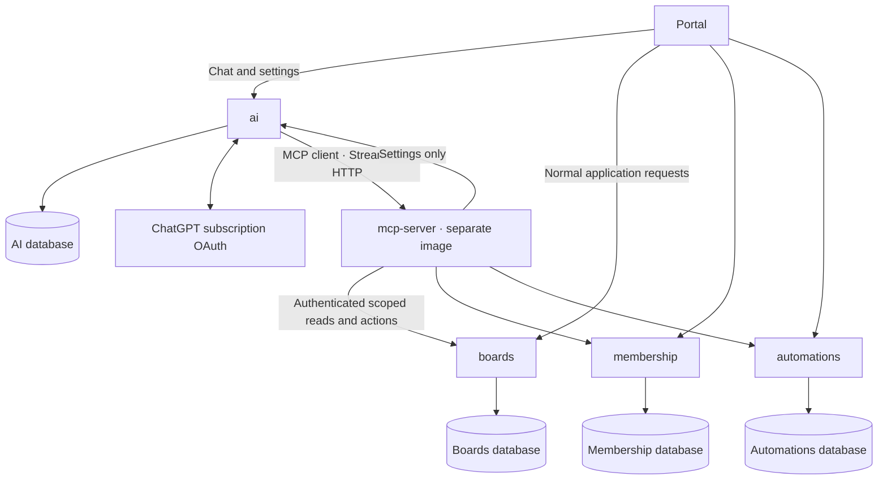

# Domus AI and MCP architecture

The AI API owns model connections, personal OAuth credentials, settings and usage metadata in its own PostgreSQL database. It also orchestrates conversations and model/tool rounds. A separately built MCP service exposes explicit read and action tools across Domus domains. Domain APIs keep permissions, business rules and their databases.



`mcp-server` exposes 23 explicit tools through the four domain APIs. It never reads another service's database, publishes directly to the queue or forwards provider tokens. Workers are invoked through their owning domain API.

| API | Read tools | Action tools |
| --- | --- | --- |
| boards | `search_cards`, `get_card`, `read_card_data`, `read_card_attachment`, `get_project_metrics` | `create_card` |
| membership | `get_my_profile` | `update_my_profile` |
| automations | `get_automation_status`, `get_automation_catalog`, `get_automation_run`, `get_automation_installation`, `list_automation_data`, `read_automation_data`, `read_automation_result`, `read_automation_catalog` | `install_automation`, `start_automation_run`, `cancel_automation_run` |
| ai | `get_ai_settings`, `get_my_ai_connection` | `set_workspace_ai_enabled`, `set_my_ai_model` |

Every tool forwards the caller's session and fixed workspace scope. Card creation also fixes the selected project. The owning API rechecks authentication, permissions and input rules on each request; MCP supplies the same-origin CSRF headers for writes. A tool annotation is descriptive, not permission or user approval. MCP clients must request explicit user review before invoking actions, especially automation execution with external effects. The current chat assistant discovers only the sixteen allowlisted read tools and rejects action calls independently in its orchestration loop and MCP client. A reviewed chat action UI is a separate step; this change does not silently grant the model write access.

Action replies come from the domain API. A queued installation or execution is not a claim of completed work; use status/run reads to track its lifecycle. Tool results are capped at 64 KiB and requests at 16 KiB. The status tool returns metrics without loading execution logs. Complete card sections, installed manifests, execution logs, installation history and catalog details are reachable through item pages and resumable JSON text chunks. Concatenate text chunks for one unchanged page before following its next item offset. Card attachment and execution-result bytes are available in base64 chunks. Cards remain project scoped and automations workspace scoped. No 100-run history cutoff or catalog release-page cutoff applies to these reads; internal runtime files and provider credentials are excluded. If records change during pagination, restart the relevant read. Secrets, password changes and OAuth connection flows are not exposed as model tools.

## Request flow

1. The AI API validates the Domus session and selected project with a small project-context read.
2. It opens a request-scoped MCP client with the user's Domus session and fixed workspace/project headers. Model arguments cannot change this identity or scope. Provider credentials never leave the AI API except to the model provider.
3. MCP discovery supplies tool schemas. The AI API translates those schemas into a `domus` function namespace for Responses. ChatGPT subscription OAuth supports locally executed function tools, but not hosted MCP/connectors; therefore the AI API executes MCP calls locally.
4. Exact project metrics are fetched through MCP. No initial card sample or full workspace state is loaded for project chat.
5. The model can search cards, refine keywords/filters, follow a cursor and retrieve relevant details. The AI API sends tool results and required reasoning/call items back in the next stateless Responses request.
6. A completed answer's card IDs must have been returned by tools during that turn. Current access and titles are checked again with a bounded query before generating links.

## Data and bounds

- AI tables: `ai_metadata`, `ai_connections`, `ai_workspaces`, `ai_usage`. The `domus_ai` database role owns only the `ai` database. Credential payloads stay encrypted with the existing per-user protection purpose; protection keys remain on the `ai-data` volume.
- Startup atomically imports existing `settings.json` once, including encrypted connections, revisions, workspace settings, usage and the OAuth host ID. A database marker prevents old file data restoring disconnected connections on restart. Keep the old volume for rollback; the running Compose service uses PostgreSQL as its source of truth.
- Lightweight API fixtures explicitly set `AI_ALLOW_FILE_STORE=true` to use the previous file store without a database connection. The API otherwise fails startup without its PostgreSQL configuration. Unit fixtures instantiate the file store directly. Compose always supplies the dedicated database connection.
- Conversations remain in service memory, bound to user/workspace/project, expire after 30 minutes, and retain six exchanges. Up to four previous exchanges are included after reference access is revalidated. A restart clears conversations.
- Search uses PostgreSQL full-text search on title and description with a GIN index, project-scoped keyset pagination and optional status, priority, completion, overdue and assignee filters. Page size is 1–50 (default 20). Queries are parameterized. Search currently matches title/description keywords, not attachment contents or semantic similarity.
- Details are bounded excerpts: description 4,000 characters, last five comments, first twenty checklist items and twenty assignees. Exact checklist total/completed counts are returned separately.
- Project metrics use database aggregates over all authorized project cards. They never count only a search page.
- Per question: six model rounds, eight model-requested tool calls, 105-second overall timeout, 120,000-character conversation payload. These are technical execution guards, not monthly subscription caps.
- Reads can observe data changing between calls; final references are revalidated. Answers and search coverage still require review. The existing portal's full-workspace loading is separate from this assistant retrieval change; this does not claim the entire UI can display a million cards at once.

## Deployment

Compose adds `mcp-server` on internal port 4340, its independent `mcp` image, and the fourth PostgreSQL database `ai`. MCP has no published host port or portal proxy route. External MCP client authentication/public hosting is outside this implementation.

Fresh volumes provision all databases automatically. Existing deployments must first run the idempotent AI provisioning script with the desired `AI_DB_PASSWORD` and the PostgreSQL administrator environment:

```sh
docker compose --project-directory infra -f infra/compose.yaml exec -T postgres sh /docker-entrypoint-initdb.d/20-ai-database.sh
```

The new mount must be available in the PostgreSQL container; on an old container copy `infra/containers/postgres/provision-ai.sh` into it and execute the copy before recreating services. Provisioning never replaces an existing role password. Back up databases and the AI protection-key volume before a production upgrade.

## Verification

- `dotnet run --project tests/Ai.Tests/Domus.Ai.Tests.csproj`: OAuth, SSE/JSON completion, streamed tool items, model/tool research loop, forbidden mutation tools, scoped conversations.
- `node tests/mcp-api.mjs`: real MCP server and SDK client, discovery/calls, project scope, pagination, origin checks and revocation.
- `AI_TEST_POSTGRES=... dotnet run --project tests/Ai.Tests/Domus.Ai.Tests.csproj`: dedicated temporary PostgreSQL schema, legacy import, encryption, CAS, concurrency and no monthly cap. The schema is removed after testing.
- `node tests/ai-api.mjs`: authentication, permissions and inputs.
- `PLAYWRIGHT_CHANNEL=chrome node tests/ai-browser.mjs`: reviewed suggestions, assistant UI, formatting and mobile behavior.
- `PLAYWRIGHT_CHANNEL=chrome node tests/integration.mjs`: fresh ten-service stack, four databases, actual indexed search beyond the former 80-card sample, cursor pagination and isolated workspaces.

Sources: [OpenAI subscription tool limitations](https://developers.openai.com/siwc/token-sharing-open-source/preview-limitations), [Responses function calling](https://developers.openai.com/api/docs/guides/function-calling), [MCP C# SDK](https://github.com/modelcontextprotocol/csharp-sdk).

## Complete data access

`get_card` remains a small overview. `read_card_data` retrieves all scalar fields, comments, checklist, labels, assignees, attachment metadata, history entries and history changes. Each section exposes `totalItems`, `nextItemOffset`, `totalCharacters` and `nextTextOffset`; long text is resumable rather than silently omitted. Attachment bytes use `read_card_attachment`.

`list_automation_data` traverses installed packages, every execution and installation attempt through owning-service SQL pages. `read_automation_data` provides manifests, execution metadata, recent log records (`logs`), the complete retained redacted execution log (`logFile`) and result-file metadata. The worker keeps 300 recent log lines in the run record and caps the persisted log at 10 MiB; MCP can retrieve every retained byte but cannot recover output already discarded by these storage limits. `read_automation_result` reads authorized result bytes; `read_automation_catalog` traverses the available catalog. These tools do not retain historical secret execution inputs: the worker deliberately deletes temporary job credentials on completion. Runtime dependencies, environment files and symlinks are excluded from results.

Availability through MCP does not mean the assistant sends every record to the model. It chooses relevant reads; the per-question tool/context limits still apply, and the answer must disclose incomplete research.
